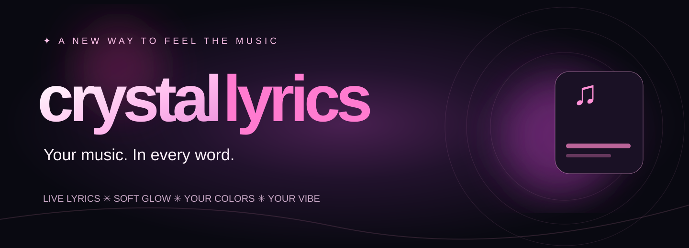

# ✦ CRYSTALLYRICS

### Your music. In every word.

**Make your favorite songs look as good as they feel.** A free, customizable lyrics experience for YouTube and YouTube Music.

[**✦ EXPLORE THE WEBSITE**](https://y2kbeatzz-dot.github.io/Crystal-Lyrics/) &nbsp;&nbsp;•&nbsp;&nbsp; [**↓ DOWNLOAD V1.4.1**](https://github.com/y2kbeatzz-dot/Crystal-Lyrics/releases/download/v1.4.1/CrystalLyrics-v1.4.1.zip) &nbsp;&nbsp;•&nbsp;&nbsp; [**✳ TRY THE LYRICS STUDIO**](https://y2kbeatzz-dot.github.io/Crystal-Lyrics/#playground)

    

---

## What's new in v1.4.1

In YouTube fullscreen, the minimized **♪ Lyrics** launcher disappears automatically so it doesn't cover the video. Your video lyrics and YouTube captions stay visible, and the launcher returns after you exit fullscreen.

## Music is more than sound.

**CrystalLyrics turns the words into the moment.** Watch lyrics come alive directly on the video, pick a look that feels like *you*, and let the visuals move with your music. No second screen. No account.

| ✦ Feel every word | ◈ Find your color | ▤ Make it yours |
| :--- | :--- | :--- |
| Word-by-word karaoke, glow, lift and fade effects. | Album artwork and optional video-inspired palettes. | Transparent, draggable, resizable lyric overlays and custom fonts. |

### Make it look how it feels.

- **Word-first visuals.** Karaoke fill, emphasis, underline, word glow, word lift, line fade and soft focus are independently adjustable.
- **Art-inspired colors.** Match your lyrics to cover art, take cues from supported video frames, or choose a manual palette.
- **Your screen, your style.** Move and resize glass lyric windows; tune transparency and typography.
- **Realistic sync options.** Supplied word timing takes priority. When only line timing is available, estimates are clearly labeled. Optional local audio timing is available.
- **Built for comfort.** Motion effects can be individually switched off; Reduce motion is on by default.

### ✧ Your song deserves a little magic.

**[VISIT THE CRYSTALLYRICS WEBSITE ↗](https://y2kbeatzz-dot.github.io/Crystal-Lyrics/)**

*The website includes an interactive visual lyrics studio. Sample lyrics and visuals are a silent concept demo, not YouTube playback.*

---

<b>Getting started / manual installation</b>

The current **CrystalLyrics v1.4.1** release is a desktop Chrome / Edge extension. It's not yet distributed through the Chrome Web Store.

1. Download the [official CrystalLyrics ZIP](https://github.com/y2kbeatzz-dot/Crystal-Lyrics/releases/download/v1.4.1/CrystalLyrics-v1.4.1.zip), then extract it to a folder you will keep.
2. Open `chrome://extensions` (or `edge://extensions`).
3. Enable **Developer mode** and choose **Load unpacked**.
4. Select the extracted **CrystalLyrics** folder containing `manifest.json`.
5. Reload YouTube or YouTube Music and enjoy.

For permissions, troubleshooting, local timing limitations, and technical details, see the [full extension documentation](extension/CrystalLyrics/README.md).

<b>Privacy, limitations and compatibility</b>

- Works on **desktop YouTube and YouTube Music**. Spotify/Apple Music streaming is not currently supported.
- Lyric lookup can send track metadata to LRCLIB; artwork lookup may contact Apple's public catalog service.
- Tab audio analysis requires explicit permission, runs locally, and may first download a model. It is optional.
- Perfect word timing isn't guaranteed for all tracks. Line timing can be estimated.
- CrystalLyrics isn't affiliated with Google or YouTube.

<b>For developers</b>

- Browser extension source: [`extension/CrystalLyrics`](extension/CrystalLyrics)
- Website: [`docs/`](docs/)
- Website deployment: automated by [Deploy CrystalLyrics website](.github/workflows/pages.yml). **One-time activation required:** open [Settings → Pages](https://github.com/y2kbeatzz-dot/Crystal-Lyrics/settings/pages), select **GitHub Actions** as the build source, save, then [re-run the website deployment](https://github.com/y2kbeatzz-dot/Crystal-Lyrics/actions/workflows/pages.yml). The public URL is `https://y2kbeatzz-dot.github.io/Crystal-Lyrics/` after a successful deployment.
- Rebuild the verified ZIP from the static release files: `python scripts/assemble-release.py`.
- The large optional offline audio runtime is bundled inside the downloadable ZIP rather than stored as an individual `.wasm` source file in Git. For a standalone unpacked extension folder, use the release ZIP.
- License: MIT for the original project code; third-party licenses and bundled font notices are retained in their respective directories.

---

© 2026 CrystalLyrics • Free & open source • Made for the music you love

